  <a href="https://wagih97.github.io"><picture><source media="(prefers-color-scheme: dark)" srcset="banner-dark.svg"></picture></a>

I study how the brain links separate memories to infer relationships it has never experienced, recording prefrontal neurons in mice during learning and the sleep that follows.

  
  
  
  
  
  
  

## Research

Specially Appointed Assistant Professor (Postdoctoral Researcher) in [Prof. Kaoru Inokuchi's laboratory](http://www.med.u-toyama.ac.jp/bmb/staff/wagih.html) at the University of Toyama, Japan, from April 2027, following my PhD in Cognitive and Emotional Neuroscience there (2023–2027).

  <picture><source media="(prefers-color-scheme: dark)" srcset="learn-dark.svg"></picture>
  <picture><source media="(prefers-color-scheme: dark)" srcset="sleep-dark.svg"></picture>
  <picture><source media="(prefers-color-scheme: dark)" srcset="infer-dark.svg"></picture>

- **Transitive inference in mice:** a head-fixed olfactory paradigm I developed, in which mice learn overlapping odor pairs (A > B, B > C, C > D, D > E) and are then tested on new pairs such as B vs D ([code and materials](https://github.com/wagih97/Marcus_Microreport_Olfactory_TI)).
- **Sleep and offline processing:** post-session chemogenetic inhibition of the medial prefrontal cortex and sleep deprivation, to test how offline processing after learning shapes later inference.
- **Prefrontal population codes:** Neuropixels 2.0 recordings during behavior and subsequent sleep, analyzed with population trajectories (PCA) and SVM decoding across learning and inference.
- **Earlier, neuropharmacology at Cairo University:** natural coumarins (umbelliferone and scoparone) in mouse models of cognition, mood and schizophrenia-like behavior.

## Technical stack

### Programming and version control

  

### Neuropixels pipeline

   &nbsp;→&nbsp;
   &nbsp;→&nbsp;
  

Acquisition → spike sorting → automated unit quality control

### Analysis and imaging

  
  

### Lab techniques

  
  
  
  
  
  
  

## Selected publications

1. **Marcus WH**, Nomoto M, Inokuchi K. A novel head-fixed olfactory paradigm for transitive inference in mice. *Molecular Brain*, submitted 2026. [Code and materials](https://github.com/wagih97/Marcus_Microreport_Olfactory_TI)
2. Rabie MA\*, **Marcus WH**\*, Sadek MA\*, et al. Repositioning of a nutraceutical, scoparone, in the management of MK-801-induced schizophrenia-like behavior in mice: an insight into SIRT1/PGC-1α/TFAM pathway. *European Journal of Pharmacology* 2025;1004:177981. [doi:10.1016/j.ejphar.2025.177981](https://doi.org/10.1016/j.ejphar.2025.177981)
3. **Marcus WH**, Ruby HA, Mousa MO, et al. Assessing cognitive, depression-, and anxiety-related effects of umbelliferone in mice. *Acta Poloniae Pharmaceutica – Drug Research* 2025;82(6):983–995. [doi:10.32383/appdr/219160](https://doi.org/10.32383/appdr/219160)
4. **Marcus WH**, Ruby HA, Awwad AE, et al. Modulatory effects of bioactive natural compounds on pruritic pathways: mechanistic basis and therapeutic prospects. *Inflammopharmacology* 2025;33:7079–7106. [doi:10.1007/s10787-025-01999-1](https://doi.org/10.1007/s10787-025-01999-1)

\* Equal contribution. Full list on [Google Scholar](https://scholar.google.com/citations?user=usUa8mYAAAAJ).

## Honors

- **Otsuka Toshimi Scholarship Foundation Scholarship** (2026–2027)
- **JNS–CNS Travel Award**, Japan Neuroscience Society and Chinese Neuroscience Society (2026)
- **Uehara Memorial Foundation Graduate Student Grant** (2024–2025)
- **Outstanding Poster Presentation Award**, University of Toyama (2023, 2024 and 2025)
- **Valedictorian**, Faculty of Pharmacy, Cairo University (2020): ranked 1st of over 1,000

---

More about my work, with real recordings and an interactive map, at <a href="https://wagih97.github.io"><b>wagih97.github.io</b></a>

